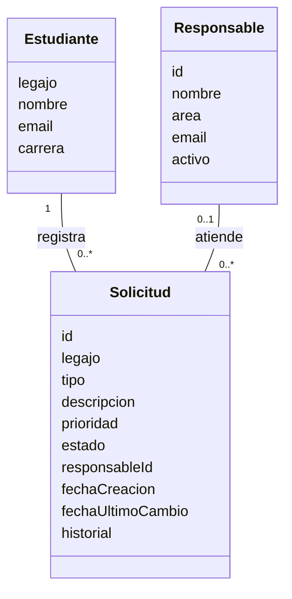
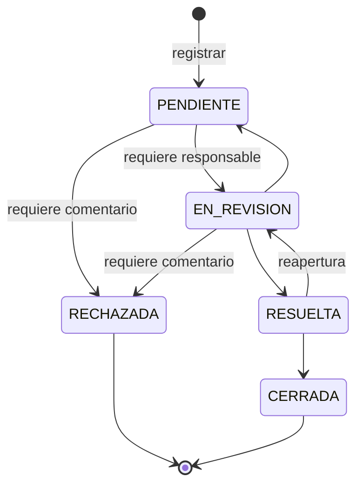
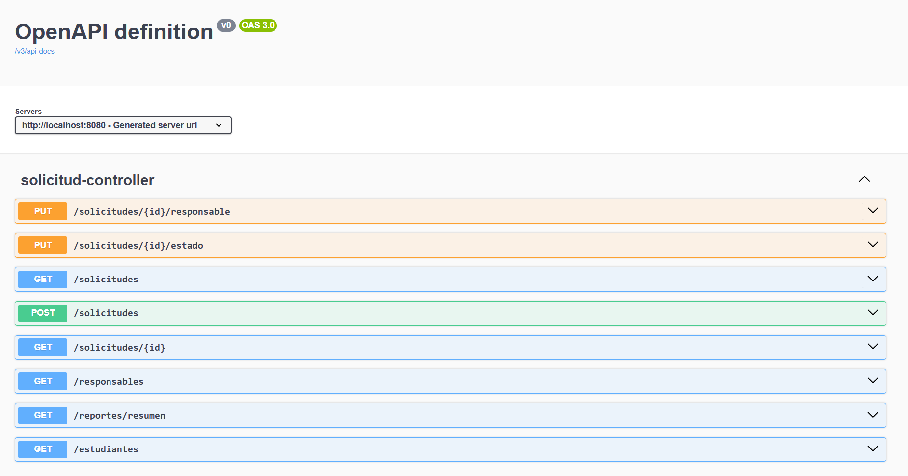
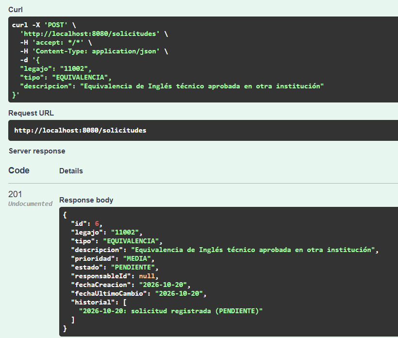
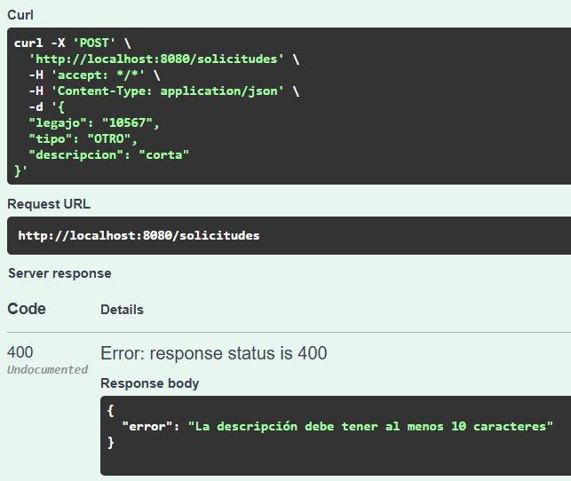
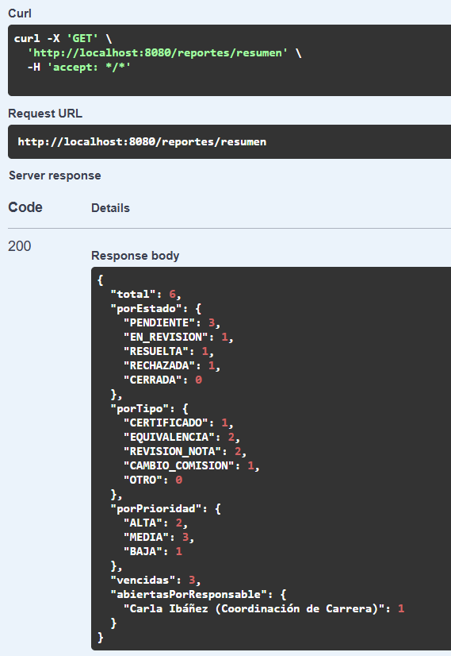

# 1. Selección y descripción del sistema base

**Responsable:** Alex · **Revisión cruzada:** Marina

## 1.1 Dominio y problema

En una facultad, los estudiantes hacen distintos pedidos administrativos: certificados, equivalencias de materias, revisiones de nota y cambios de comisión. Si esos pedidos llegan por correo o en papel, no hay forma simple de saber en qué estado está cada uno, quién lo atiende ni cuáles están demorados.

El **Sistema de Gestión de Solicitudes Académicas** centraliza esos pedidos: registra cada solicitud, la clasifica por tipo, prioridad y estado, permite asignarle un responsable, seguir su evolución y obtener un resumen general.

Es el caso sugerido por la cátedra. Lo elegimos porque es un dominio que conocemos como estudiantes y porque tiene reglas de negocio concretas (transiciones de estado, prioridades, vencimientos) donde los problemas de diseño se notan.

## 1.2 Alcance

**Incluye:**

- Registro de solicitudes, con alta automática del estudiante si todavía no existe.
- Clasificación por tipo, prioridad y estado.
- Cambio de estado según un flujo de transiciones definido.
- Asignación de un responsable de área.
- Búsqueda con filtros y consulta individual.
- Reporte resumen con totales y solicitudes vencidas.
- Persistencia en un archivo JSON con datos de prueba sintéticos.

**No incluye:**

- Interfaz gráfica: el sistema se usa a través de su API REST (con Swagger UI para probarla).
- Autenticación y roles de usuario.
- Envío de notificaciones por correo.
- Base de datos relacional.

Estas exclusiones son intencionales: la consigna pide un módulo acotado, porque el foco del trabajo está en la calidad interna y no en la cantidad de funcionalidades.

## 1.3 Actores

| Actor | Qué hace en el sistema |
|---|---|
| Estudiante | Registra solicitudes y consulta su estado |
| Personal administrativo (responsable de área) | Toma solicitudes, cambia su estado y deja comentarios |
| Coordinación / Secretaría Académica | Asigna responsables, filtra solicitudes y consulta el reporte |

Como el sistema no tiene autenticación, los actores se distinguen por la operación que usan, no por un usuario logueado.

## 1.4 Entidades

| Entidad | Descripción |
|---|---|
| **Solicitud** | Pedido de un estudiante. Tiene tipo, prioridad, estado, responsable asignado e historial de cambios |
| **Estudiante** | Quien hace la solicitud. Se identifica por legajo |
| **Responsable** | Persona de un área (Bedelía, Secretaría Académica, Coordinación de Carrera, Tesorería) que atiende solicitudes. Puede estar activo o inactivo |

Valores de clasificación:

- **Tipo:** `CERTIFICADO`, `EQUIVALENCIA`, `REVISION_NOTA`, `CAMBIO_COMISION`, `OTRO`
- **Prioridad:** `ALTA`, `MEDIA`, `BAJA`
- **Estado:** `PENDIENTE`, `EN_REVISION`, `RESUELTA`, `RECHAZADA`, `CERRADA`

## 1.5 Funcionalidades

| # | Operación | Endpoint | Resultado |
|---|---|---|---|
| F1 | Registrar solicitud | `POST /solicitudes` | `201` con la solicitud creada en estado `PENDIENTE` |
| F2 | Buscar y filtrar | `GET /solicitudes?estado=&tipo=&prioridad=&legajo=&responsableId=&vencidas=` | `200` con la lista ordenada por prioridad (ALTA primero) y luego por id |
| F3 | Consultar una solicitud | `GET /solicitudes/{id}` | `200` con la solicitud o `404` |
| F4 | Cambiar estado | `PUT /solicitudes/{id}/estado` con `{"estado", "comentario"}` | `200` con la solicitud actualizada |
| F5 | Asignar responsable | `PUT /solicitudes/{id}/responsable` con `{"responsableId"}` | `200` con la solicitud actualizada |
| F6 | Reporte resumen | `GET /reportes/resumen` | Totales por estado, tipo y prioridad, cantidad de vencidas y solicitudes abiertas por responsable |
| F7 | Catálogos | `GET /estudiantes`, `GET /responsables` | Listados de referencia |

Los errores se devuelven como `{"error": "mensaje"}` con código `400` (dato inválido), `404` (no existe) o `409` (viola una regla de negocio).

## 1.6 Reglas de negocio

Estas reglas definen el **comportamiento externo** que el refactoring tiene que conservar. Son la base de las pruebas de caracterización.

| Regla | Descripción | Respuesta si no se cumple |
|---|---|---|
| RN-01 | El legajo es obligatorio y tiene 5 dígitos | `400` |
| RN-02 | El tipo es obligatorio y debe ser uno de los válidos (no distingue mayúsculas) | `400` |
| RN-03 | La descripción tiene entre 10 y 500 caracteres | `400` |
| RN-04 | Si no se indica prioridad, se calcula por tipo: `REVISION_NOTA` → ALTA; `EQUIVALENCIA` y `CAMBIO_COMISION` → MEDIA; el resto → BAJA | — |
| RN-05 | Si el estudiante no existe, se da de alta: requiere nombre y un email válido | `400` |
| RN-06 | Un estudiante no puede tener dos solicitudes abiertas (`PENDIENTE` o `EN_REVISION`) del mismo tipo | `409` |
| RN-07 | Las transiciones de estado permitidas son las del diagrama de abajo; `RECHAZADA` y `CERRADA` son estados finales | `409` |
| RN-08 | Para pasar a `EN_REVISION` la solicitud debe tener responsable | `409` |
| RN-09 | Para rechazar una solicitud hay que indicar un comentario | `400` |
| RN-10 | No se asigna responsable a una solicitud `RECHAZADA` o `CERRADA` | `409` |
| RN-11 | El responsable debe existir y estar activo | `404` / `409` |
| RN-12 | Un responsable no puede tener más de 5 solicitudes abiertas | `409` |
| RN-13 | Al asignar responsable a una solicitud `PENDIENTE`, pasa automáticamente a `EN_REVISION` | — |
| RN-14 | Una solicitud abierta está vencida si pasaron más de 3 (ALTA), 7 (MEDIA) o 15 (BAJA) días desde su creación | — |
| RN-15 | Cada cambio queda registrado en el historial de la solicitud con la fecha | — |

## 1.7 Tecnología y estructura de la versión inicial

| Aspecto | Elección |
|---|---|
| Lenguaje | Java 17 |
| Framework | Spring Boot 3.3 (Spring Web) |
| Build | Maven, con Maven Wrapper |
| Persistencia | Archivo `datos/solicitudes.json` (Jackson) |
| Documentación de la API | springdoc-openapi (Swagger UI) |
| Pruebas | JUnit 5 + MockMvc (disponibles; la versión inicial no tiene pruebas) |

Elegimos Spring Boot porque es la tecnología que vimos en Programación y la que usamos en el Trabajo Final, así las tres podemos leer, modificar y defender el código. La justificación completa está en [10_decisiones_tecnicas.md](10_decisiones_tecnicas.md).

Estructura de la versión inicial (tag `estado-inicial`):

| Archivo | Líneas | Contenido |
|---|---|---|
| `controlador/SolicitudController.java` | 441 | Todos los endpoints y la lógica del sistema |
| `datos/BaseDeDatos.java` | 156 | Listas en memoria, lectura/escritura del JSON y datos de prueba |
| `modelo/Solicitud.java`, `Estudiante.java`, `Responsable.java` | 210 | Clases con atributos, getters y setters |
| `SolicitudesApplication.java` | 14 | Arranque de la aplicación |

El análisis de esta estructura está en las secciones 2 y 3.

## 1.8 Origen de la versión inicial

La versión inicial es un **prototipo construido por el equipo para este trabajo**, como permite la consigna. Se armó como un prototipo rápido: se priorizó que las funcionalidades anduvieran y no se cuidó el diseño interno. Así quedó una versión base con problemas reales para diagnosticar. Para generarla se usó asistencia de IA; el detalle está en [09_uso_ia.md](09_uso_ia.md).

## 1.9 Cumplimiento de los requisitos mínimos

| Requisito de la consigna | Cómo se cumple |
|---|---|
| Al menos 3 entidades | Solicitud, Estudiante y Responsable, más los valores de tipo, prioridad y estado |
| Al menos 4 operaciones verificables | F1 a F6 (seis operaciones) |
| Persistencia de datos | Archivo JSON |
| Versión inicial con problemas reales | Tag `estado-inicial`; el diagnóstico está en la sección 3 |
| Demostrar que se conserva el comportamiento | Pruebas de caracterización (sección 6) |

## 1.10 Evidencia de funcionamiento

La ejecución completa de las operaciones, con cada pedido y su respuesta, está en [evidencias/etapa1/ejecucion_api.md](evidencias/etapa1/ejecucion_api.md). Estas capturas muestran el sistema funcionando desde Swagger UI.

**Endpoints disponibles**

**F1 – Registrar solicitud.** El sistema responde `201`, asigna el id, calcula la prioridad a partir del tipo (RN-04) y deja la solicitud en `PENDIENTE` con su primera entrada en el historial.

**F1 – Validación.** Una descripción de menos de 10 caracteres se rechaza con `400` y un mensaje claro (RN-03).

**F6 – Reporte resumen.** Totales por estado, tipo y prioridad, solicitudes vencidas y solicitudes abiertas por responsable.

## 1.11 Repositorio

- Repositorio: <https://github.com/Alex-Dauria/tpi-ms2-gestion-solicitudes>
- Versión inicial: tag [`estado-inicial`](https://github.com/Alex-Dauria/tpi-ms2-gestion-solicitudes/tree/estado-inicial)
