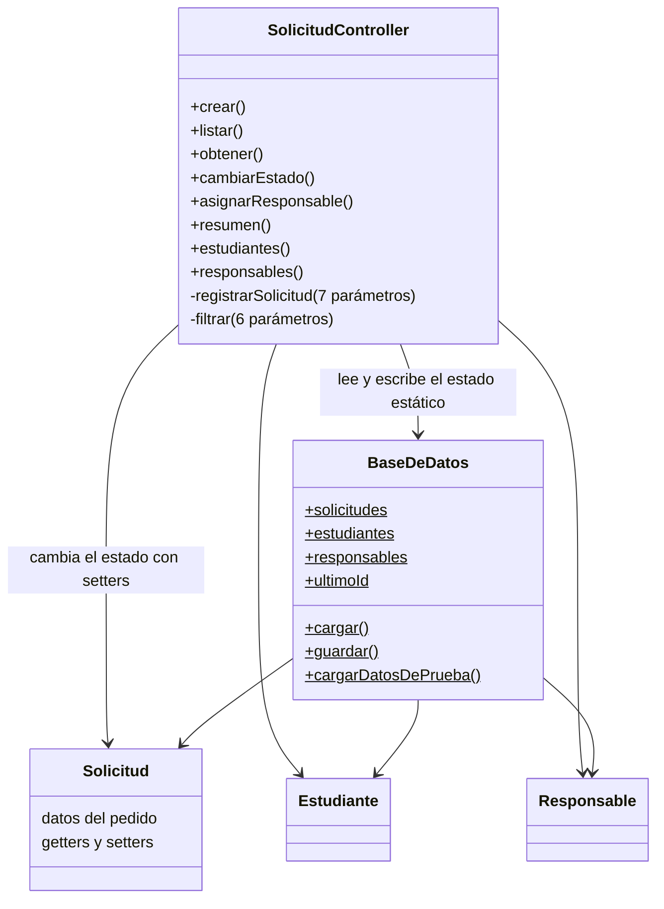
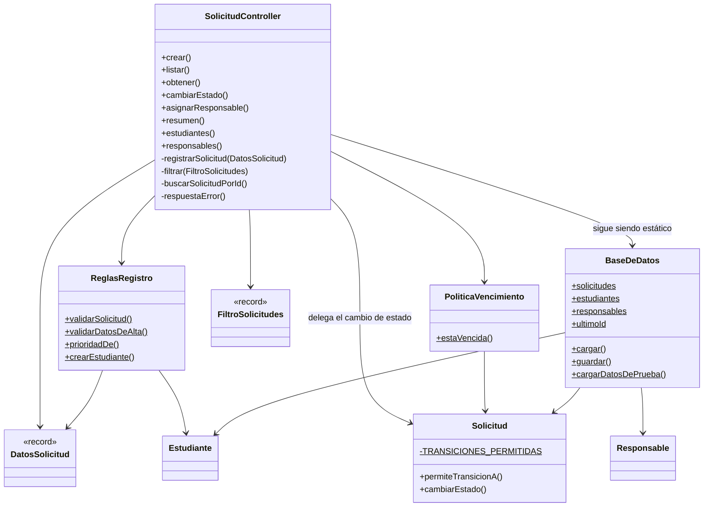

# 4. Aplicación de SOLID y Clean Code

**Consolida:** Alex · **Revisión cruzada:** Marina
**Aportes por zona:** A – Alex · B – Marina · C – Silvia

> La consigna pide mejoras vinculadas a SRP, OCP, LSP, ISP y DIP **cuando corresponda**, y mejoras de nombres, funciones, manejo de errores, cohesión, acoplamiento y límites entre componentes. Si un principio no aplica, hay que justificar por qué; no se fuerza.

## Aportes por zona

### Zona A – Registro (Alex)

- **SRP:** `registrarSolicitud` hacía siete cosas en 105 líneas (SA-01). Ahora coordina: cada responsabilidad tiene su método (validar cada campo, validar y crear al estudiante, buscar la solicitud abierta, construir la solicitud) y el método principal se lee como una secuencia de pasos (RA-04, RA-05 y RA-06). Además, las reglas RN-01 a RN-05 salieron del controlador a `ReglasRegistro`, que no conoce HTTP ni la persistencia (RA-09 y RA-10). De esta zona quedan en el controlador la coordinación del pedido y las búsquedas y la construcción de la solicitud, que dependen del acceso a datos (zona C) y de las reglas de estado (zona B).
- **OCP:** parcial. Con las listas `TIPOS_VALIDOS` y `PRIORIDADES_VALIDAS` (RA-07), agregar un tipo ya no obliga a tocar la condición de validación, pero sí `prioridadPorDefecto` y el reporte. Cerrarlo del todo requiere un `enum` de tipo que conozca su prioridad (*Replace Type Code with Class*), que queda propuesto para coordinar con la zona C.
- **LSP, ISP y DIP:** no aplican a esta zona. No hay jerarquías ni interfaces en el registro, y la dependencia con `BaseDeDatos` es de la zona C. El controlador usa `ReglasRegistro` directamente: son reglas sin acceso a datos ni a servicios externos, así que una interfaz no agregaría nada que hoy haga falta reemplazar.
- **Clean Code:**
  - **Funciones:** el método principal pasó de 105 a 33 líneas y de 19 decisiones a 4, en métodos que hacen una sola cosa.
  - **Argumentos:** de siete `String` a un `DatosSolicitud` (RA-03).
  - **Manejo de errores:** un solo `respuestaError` para las 22 respuestas (RA-01), y las validaciones devuelven `Optional` en lugar de cortar el flujo con `return` en el medio del método.
  - **Nombres:** los comentarios que rotulaban bloques (`// validaciones`, `// buscar estudiante`) pasaron a ser nombres de métodos, y desaparecieron `m`, `est`, `e` y la `s` reutilizada.
  - **Valores mágicos:** constantes con nombre (RA-07).
  - **Código muerto:** se eliminaron el `TODO` y el `println` comentado (RA-08).

### Zona B – Ciclo de vida (Marina)

- **SRP y cohesión:** RB-01 reubica la decisión sobre las transiciones permitidas desde `SolicitudController` hacia `Solicitud.permiteTransicionA` (SB-01 / S-03). RB-03 reúne en `Solicitud.cambiarEstado` las comprobaciones de la transición, el responsable y el comentario, y la actualización del estado, historial y fecha (SB-04 / S-04). La entidad usa su propio estado y el controlador delega la operación. La mejora de SRP es parcial: el controlador conserva validaciones para producir las respuestas HTTP y sigue coordinando el acceso a `BaseDeDatos` y la persistencia.
- **Encapsulación:** RB-03 comprueba las condiciones antes de modificar la solicitud; una operación rechazada no cambia estado, historial ni fecha. La asignación automática conserva primero la entrada de asignación del responsable y después la de transición a `EN_REVISION`, con una misma fecha. SB-04 / S-04 queda **parcialmente resuelto**: `setEstado()` sigue siendo público para inicialización y compatibilidad con la persistencia JSON, por lo que todavía puede eludirse la operación de dominio. No se afirma que todas las invariantes estén protegidas.
- **OCP:** mejora limitada. RB-02 reemplaza la cadena condicional por una tabla estática e inmutable de transiciones; la consulta no cambia al ajustar sus entradas, pero modificar las reglas todavía requiere editar la tabla. Los estados continúan como `String`: RB-02 no resuelve SB-03 / S-10 ni implica cumplimiento completo de OCP.
- **LSP, ISP y DIP:** no fueron objeto de mejoras en esta zona. No se introdujeron jerarquías, interfaces ni inversión de dependencias; se conserva la dependencia del controlador con `BaseDeDatos`.
- **Clean Code:** RB-04 extrae `buscarSolicitudPorId` para las tres operaciones que repetían el recorrido de solicitudes (SB-02 / S-09), conservando la primera instancia coincidente y la respuesta `404`. RB-05 introduce `MAX_SOLICITUDES_POR_RESPONSABLE = 5` y utiliza el mismo valor en la condición y el mensaje (SB-05 / S-11). Los nombres expresan la intención, la búsqueda queda en un solo lugar y la operación de cambio de estado concentra sus efectos. Se mantienen el orden de las validaciones, los códigos HTTP y los mensajes existentes.
- **Decisión pendiente:** se posterga el `enum EstadoSolicitud` propuesto en SB-03 / S-10. El estado también interviene en consultas, reportes, datos sintéticos y JSON persistido; cambiar su tipo requiere coordinar esos consumidores y verificar la representación externa, las entradas inválidas y su orden de validación. No es una incompatibilidad inevitable con Jackson, sino un cambio de mayor alcance que se separa de RB-01 a RB-05.

### Zona C – Consultas y persistencia (Silvia)

- **SRP:** `filtrar` recibía seis parámetros sueltos y hacía todo el filtrado en un método; con RC-01 coordina los criterios a través de `FiltroSolicitudes` y con RC-03 la regla de vencimiento sale del controlador y queda en `PoliticaVencimiento`.
- **Clean Code:**
  - **Funciones/argumentos:** de seis parámetros sueltos a un objeto con nombre (`FiltroSolicitudes`, RC-01).
  - **Encapsulamiento:** `estudiantes()` y `responsables()` devuelven `List.copyOf` (RC-02), protegiendo el estado global.
- **OCP/LSP/ISP:** no aplican a esta zona; no hay jerarquías ni interfaces en las consultas.
- **DIP:** el problema existe: el controlador depende directamente de la clase estática `BaseDeDatos`. Queda como mejora pendiente (S-06).

## 4.1 Principios SOLID

| Principio | Problema en la versión inicial (smell S-xx) | Mejora aplicada | Refactoring (R-xx) | Zona |
|---|---|---|---|---|
| SRP – Responsabilidad única | El controlador validaba, decidía transiciones, calculaba vencimientos y persistía (S-01, S-03, S-05) | Las reglas del registro pasan a `ReglasRegistro`, las transiciones a `Solicitud` y el vencimiento a `PoliticaVencimiento`. Mejora parcial: el controlador conserva parte de la validación y el armado del reporte | RA-02, RA-04 a RA-06, RA-09, RA-10, RB-01, RB-03, RC-03 | A, B, C |
| OCP – Abierto/cerrado | Agregar un tipo o una transición obligaba a tocar condicionales (S-03, S-08) | Mejora parcial: listas de valores válidos y tabla de transiciones. Agregar un valor todavía requiere editar esas constantes, porque no se introdujeron extensiones | RA-07, RB-02 | A, B |
| LSP – Sustitución de Liskov | No aplica: no hay herencia ni jerarquías | Sin cambios. No se fuerzan jerarquías que el dominio no necesita | – | – |
| ISP – Segregación de interfaces | No aplica: el proyecto no define interfaces | Sin cambios. No hay clientes obligados a depender de métodos que no usan | – | – |
| DIP – Inversión de dependencias | El controlador depende de la clase concreta y estática `BaseDeDatos` (S-06) | **No se mejoró.** Queda como mejora pendiente | – | C |

**SRP.** En la versión inicial, `SolicitudController` tenía todas las razones de cambio del sistema: una regla del registro, una transición o un plazo de vencimiento se cambiaban en el mismo archivo de 441 líneas. Ahora cada una de esas reglas tiene un lugar propio: cambiar una validación del registro toca `ReglasRegistro`; cambiar una transición, `Solicitud`; cambiar un plazo, `PoliticaVencimiento`. La mejora es parcial, porque el controlador todavía repite las comprobaciones de RN-08 y RN-09 para responder el código HTTP correcto, y `filtrar` y `resumen` siguen siendo métodos largos.

**OCP.** La lista `TIPOS_VALIDOS` y la tabla `TRANSICIONES_PERMITIDAS` reemplazan condicionales: agregar un valor ya no cambia la lógica que lo consulta. No lo consideramos cumplido del todo: hay que editar la constante, un tipo nuevo también afecta `prioridadPorDefecto` y el reporte, y los estados siguen siendo `String` (S-10).

**LSP e ISP.** El proyecto no tiene herencia ni interfaces propias, y el dominio no las necesitó para resolver los smells del catálogo. Agregarlas solo para mostrar el principio sumaría complejidad sin reducir el costo de ningún cambio.

**DIP.** El controlador usa directamente `BaseDeDatos`, y también `ReglasRegistro` de forma estática. Para invertir la dependencia de los datos haría falta un repositorio con una interfaz y sacar el estado estático (S-06). Ese cambio atraviesa todos los endpoints y las pruebas de las tres zonas, así que se dejó afuera de esta etapa. Es la principal deuda que queda en el diseño.

## 4.2 Clean Code

| Aspecto | Antes | Después | Zona |
|---|---|---|---|
| Nombres | `m`, `est`, `e`, una `s` reutilizada; comentarios como `// validaciones` que rotulaban bloques | Nombres que dicen qué hacen: `buscarEstudiantePorLegajo`, `permiteTransicionA`, `buscarSolicitudPorId`. **Pendiente:** `lst`, `ok`, `venc`, `porResp`, `x` y `k` en `filtrar` y `resumen` | A, B |
| Funciones (tamaño, un solo nivel de abstracción) | `registrarSolicitud`: 105 líneas, 19 decisiones y 7 parámetros. `cambiarEstado`: 64 líneas. `filtrar`: 64 líneas y 6 parámetros. `resumen`: 60 líneas | `registrarSolicitud`: 33 líneas, 4 decisiones y 1 parámetro. `cambiarEstado`: 30 líneas. `filtrar`: 53 líneas y 1 parámetro. **Pendiente:** `filtrar`, `resumen` (53 líneas) y `asignarResponsable` (50 líneas) siguen siendo largos | A, B, C |
| Manejo de errores | La respuesta de error se armaba a mano en cada lugar (S-02) | Un solo `respuestaError`; las validaciones del registro devuelven `Optional<String>`. **Se conserva a propósito:** el legajo numérico sigue dando `500` (CP-A25), porque corregirlo cambiaría el comportamiento externo | A |
| Comentarios y código muerto | Un `TODO` y un `println` comentado | Eliminados (RA-08). Los comentarios que quedan explican reglas, no rotulan bloques | A |
| Números y textos mágicos | 5, 10, 500 y las listas del registro; el límite de 5 asignaciones; 3, 7 y 15 días (S-08, S-11) | Constantes con nombre (RA-07, RB-05, RC-03). **Pendiente:** los estados siguen escritos como texto (S-10) | A, B, C |

## 4.3 Cohesión, acoplamiento y límites entre componentes

### Antes

Todas las reglas estaban en el controlador y las entidades solo guardaban datos. **La cohesión era baja**, porque una clase mezclaba HTTP, validación, transiciones, vencimientos y reportes. **El acoplamiento era alto**, porque cualquier operación accedía directamente al estado global.

### Después

| Componente | Responsabilidad | Depende de |
|---|---|---|
| `SolicitudController` | Recibir los pedidos, coordinar y armar las respuestas. Todavía filtra y arma el reporte | Todos los demás |
| `ReglasRegistro` | Reglas RN-01 a RN-05 del registro | `DatosSolicitud`, `Estudiante` |
| `PoliticaVencimiento` | Regla RN-14 de vencimiento | `Solicitud` |
| `Solicitud` | Sus datos, sus transiciones permitidas y el cambio de estado con historial | Nada de las capas superiores |
| `BaseDeDatos` | Estado en memoria y persistencia en JSON, juntos (S-06) | Las entidades |
| `DatosSolicitud`, `FiltroSolicitudes` | Agrupar datos que viajan juntos | Nada |

**Cohesión.** Mejoró donde se movieron reglas: `ReglasRegistro` solo conoce el registro, y `Solicitud` ahora protege su propio cambio de estado. En el controlador mejoró de forma parcial: pasó de 441 a 361 líneas, y aún concentra el filtrado y el reporte.

**Acoplamiento.** Las reglas dejaron de depender de HTTP: `ReglasRegistro` y `PoliticaVencimiento` no usan clases de Spring, y se pueden leer y cambiar sin tocar los endpoints. Sin embargo, el controlador conoce más clases que antes y todas se usan de forma directa. El acoplamiento con `BaseDeDatos` no cambió.

**Límites.** Quedó más clara la frontera entre el dominio (`modelo`), las reglas (`servicio`), la entrada HTTP (`controlador`) y los datos (`datos`). Sigue abierta en tres puntos: `setEstado()` sigue siendo público por la persistencia JSON (S-04 parcial), las comprobaciones de RN-08 y RN-09 están también en el controlador, y `BaseDeDatos` mezcla estado y persistencia (S-06).
